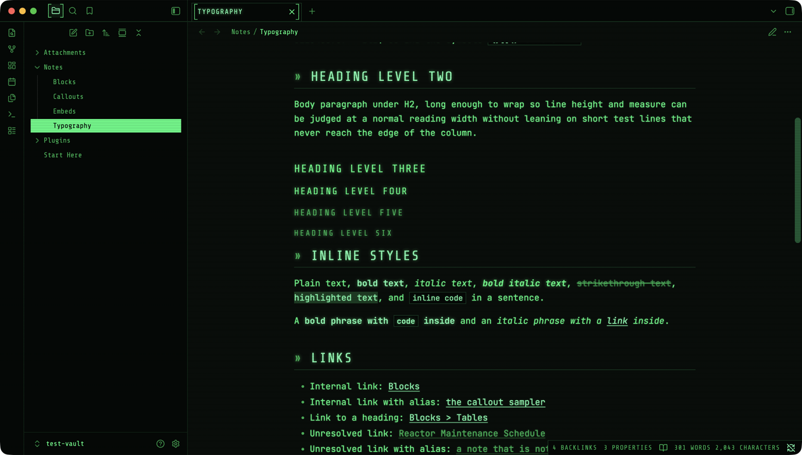
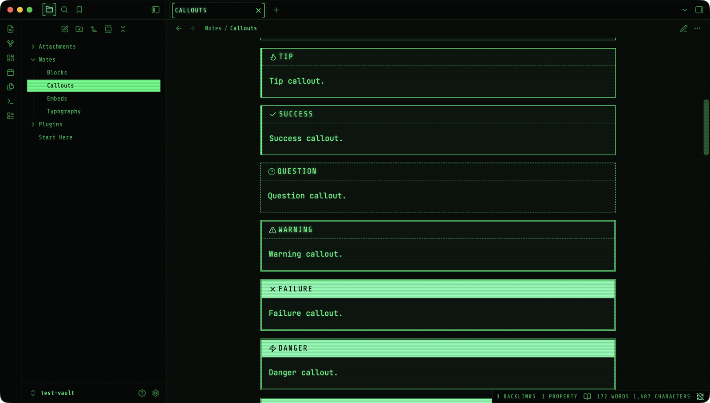
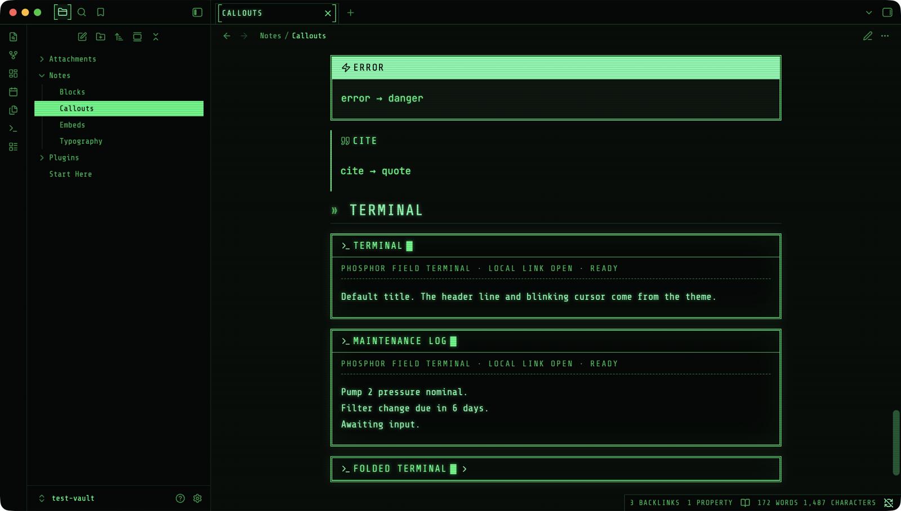
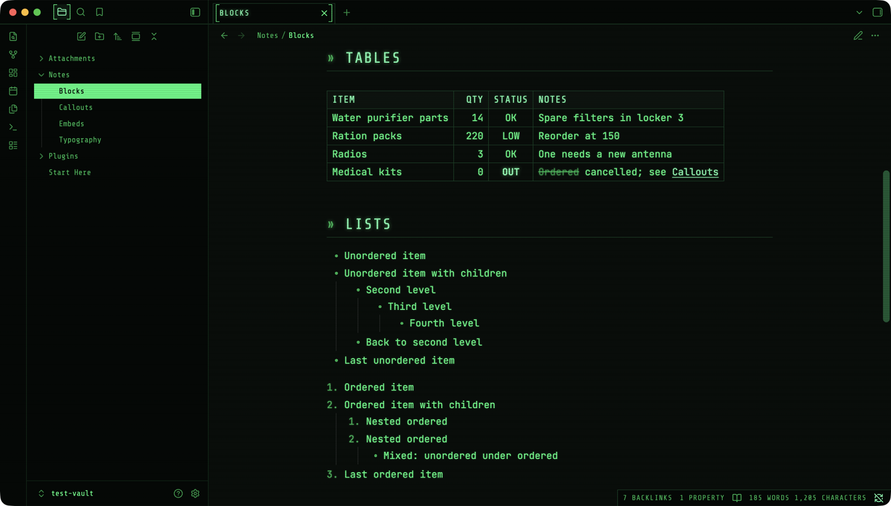
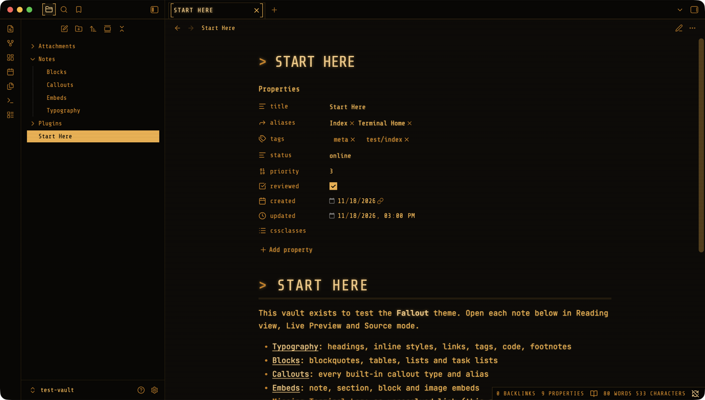
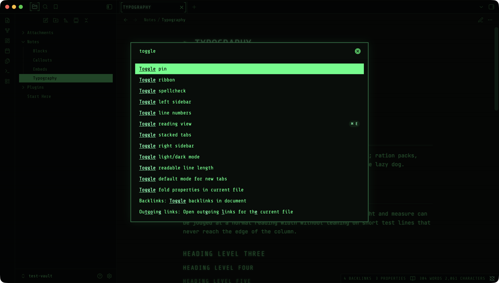

# Fallout

> Fallout is an unofficial fan-made theme. It is not affiliated with, endorsed by, or associated with Bethesda Softworks, ZeniMax Media, or Microsoft. Fallout is a trademark of Bethesda Softworks LLC.

A phosphor-terminal theme for [Obsidian](https://obsidian.md), inspired by wrist-computer and wall-terminal screens. It uses one hue on near-black, and separates everything by brightness, weight and type rather than colour. Everything is original CSS. It contains no game assets, logos, artwork, fonts or sounds.

**Dark mode only (v1).** If Obsidian is set to light mode, Fallout still shows its dark terminal palette.



## Features

- **Single-hue palette.** Every surface, border, text level and state is the same hue at a different brightness. Obsidian's named colours (red, blue, purple…) are remapped onto that ramp too, so nothing falls back to the default purple.
- **Four phosphor colours.** Green (default), Amber, White and Blue. Each one regenerates the whole ramp (see [Style Settings](#style-settings)).
- **Hierarchy without colour:**
  - **Headings:** uppercase terminal headings, with `> ` before H1 and `» ` before H2.
  - **Links:** solid underline for internal links, dashed for external links, dotted and dimmer for unresolved ones.
  - **Tags:** shown in brackets as `[#TAG]`.
  - **Bold:** brightest level with a stronger glow.
  - **Inline code:** in a box.
- **Top-bar tabs.** Tab titles are uppercase. The active tab sits inside drawn square brackets, and inactive tabs are dimmed.
- **Menu-style selection.** The open file in the file explorer and outline is a solid bar with dark text, and hover shows a dimmer bar. The command palette, quick switcher, context menus and the settings sidebar work the same way.
- **`[!terminal]` callout.** A terminal screen inside a note, with its own header line and a blinking block cursor after the title.
- **Terminal callouts.** Every built-in callout is a bordered box with its icon kept. Types differ by brightness and border style: solid, thick-edged, dashed, ruled, double, and double with an inverted title bar.
- **Task checkboxes as `[ ]` and `[X]`.**
- **CRT effects.** A subtle text glow and a faint scanline overlay, plus an optional vignette and an optional one-time power-on flicker.
- **Themed throughout:** scrollbars, modals, the command palette, settings, toggles, the status bar, Canvas and the graph view.
- **Plugin support:** Dataview (tables, inline fields, errors), Kanban (lanes and cards) and Calendar (compact grid, underlined today).
- **Accessible:**
  - Body text meets WCAG AA contrast in every palette with glow turned off.
  - Glow never carries readability on its own.
  - Animations stop when your system asks for reduced motion.
- **Prints cleanly.** PDF export comes out as dark ink on white, with no glow or overlays.
- **No network requests.** Fonts are embedded.

### The `[!terminal]` callout

```markdown
> [!terminal] Maintenance log
> Pump 2 pressure nominal.
> Filter change due in 6 days.
```

## Style Settings

Install the [Style Settings](https://github.com/mgmeyers/obsidian-style-settings) plugin, then open Settings → Style Settings → Fallout.

| Setting | Options | Default |
| --- | --- | --- |
| Phosphor colour | Green, Amber, White, Blue | Green |
| Turn off glow | On / off | Off (glow shows) |
| Glow strength | 0.25–3 | 1 |
| Turn off scanlines | On / off | Off (scanlines show) |
| Scanline intensity | 0.04–0.5 | 0.18 |
| CRT vignette | On / off | Off |
| Load flicker | On / off. Never runs under reduced motion. | Off |
| Body font | Readable mono (JetBrains Mono), Terminal mono (Share Tech Mono) | Readable mono |

Without Style Settings, the defaults in the right-hand column apply.

## Screenshots

| | |
| --- | --- |
|  |  |
|  |  |
|  |  |

<!-- Gallery thumbnail for the Obsidian theme browser: screenshot.png, 512×288. Screenshots show the theme only. -->

## Installation

**From Obsidian:** Settings → Appearance → Themes → Manage → search for **Fallout** → Install and use.

**Manually:** copy `theme.css` and `manifest.json` into `<your vault>/.obsidian/themes/Fallout/`, then pick Fallout under Settings → Appearance.

Fallout needs Obsidian 1.8 or later.

## Development

`theme.css` is generated by a build script. Edit `src/theme.src.css`, then run:

```sh
python3 scripts/build.py
```

The script embeds the fonts from `fonts/` as base64 WOFF2. `theme.css` is committed, because Obsidian installs it straight from the repository.

The source is organised as variables → typography → layout → components → core views and plugins → Style Settings.

`test-vault/` is an Obsidian vault with sample notes. They cover headings, inline styles, links, tags, code, footnotes, blockquotes, tables, lists, tasks, every callout, embeds and properties, plus Dataview, Kanban, Calendar and Canvas samples. Its `.obsidian/themes/Fallout/` folder symlinks to the repo's `theme.css` and `manifest.json`. Obsidian only notices a change when the link itself changes, so the build script recreates the link and the open vault picks up the new CSS straight away. Where symlinks don't work, run `scripts/sync-test-vault.sh` to copy the files instead.

### Releasing

1. Bump `version` in `manifest.json`.
2. Run `python3 scripts/build.py`.
3. Commit.
4. Push a tag that matches the version, for example `0.1.0`.

The release workflow checks that the tag matches the manifest and that `theme.css` is up to date. It then creates a GitHub release with `theme.css` and `manifest.json` attached.

## Privacy and network access

Fallout makes **no network requests**. Both fonts are embedded in `theme.css` as base64 WOFF2, and the file contains no URLs.

## Font credits

| Font | Used for | Designer | Licence |
| --- | --- | --- | --- |
| Share Tech Mono | Headings, interface | Carrois Apostrophe | [SIL OFL 1.1](fonts/OFL-ShareTechMono.txt) |
| JetBrains Mono | Body text, code | The JetBrains Mono Project Authors | [SIL OFL 1.1](fonts/OFL-JetBrainsMono.txt) |

The OFL allows these fonts to be bundled and redistributed with software as long as they aren't sold on their own. The fonts stay under the OFL; the MIT licence below doesn't cover them.

## License

Theme code: [MIT](LICENSE) © 2026 leolloydc.
Embedded fonts: SIL Open Font License 1.1 (see above).
